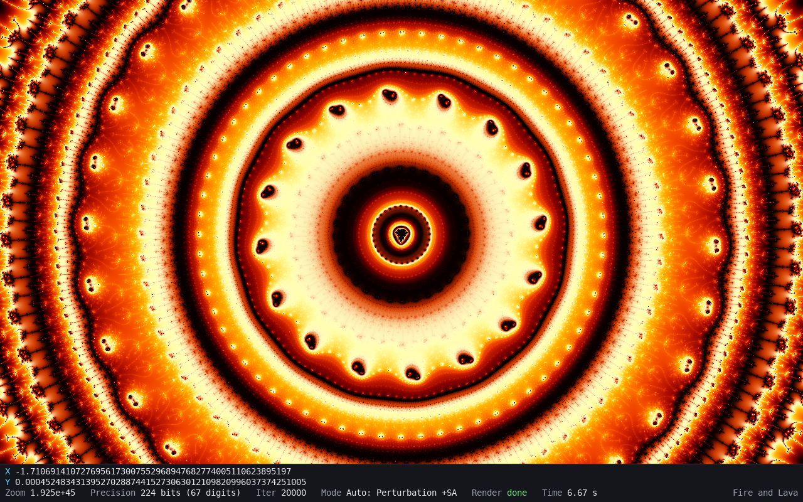
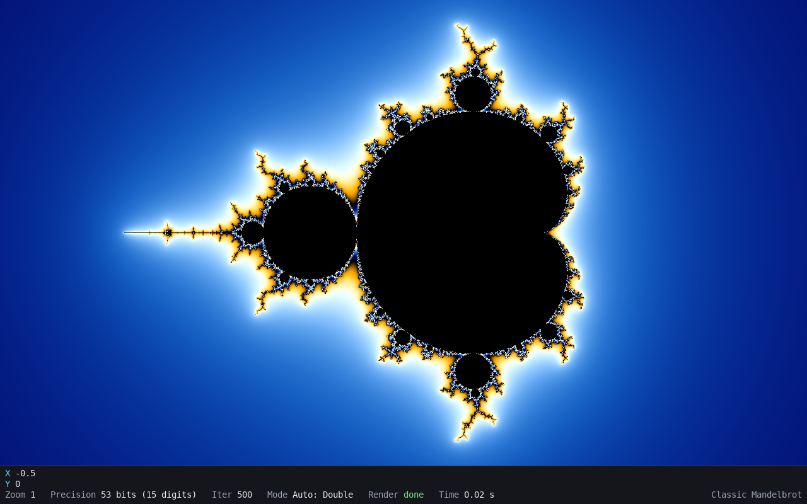
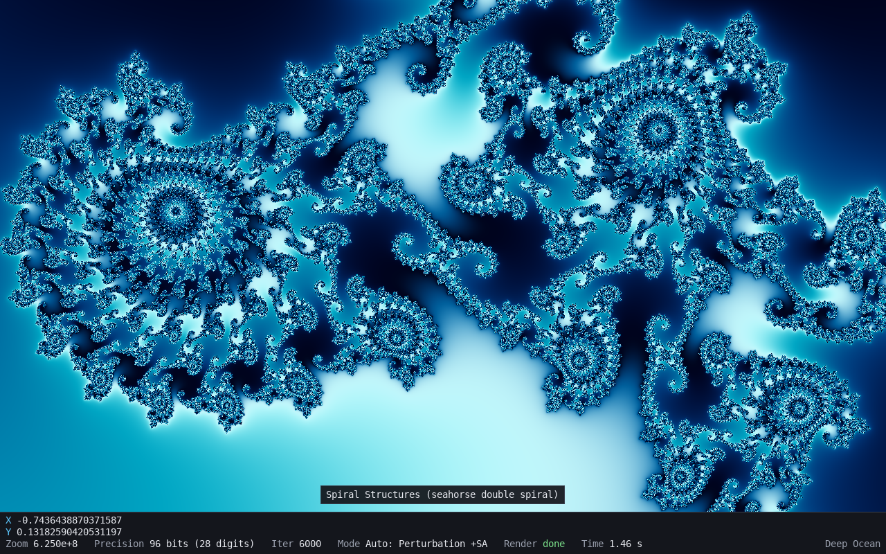
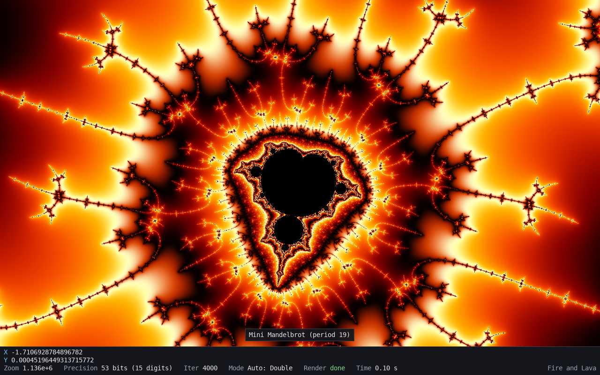
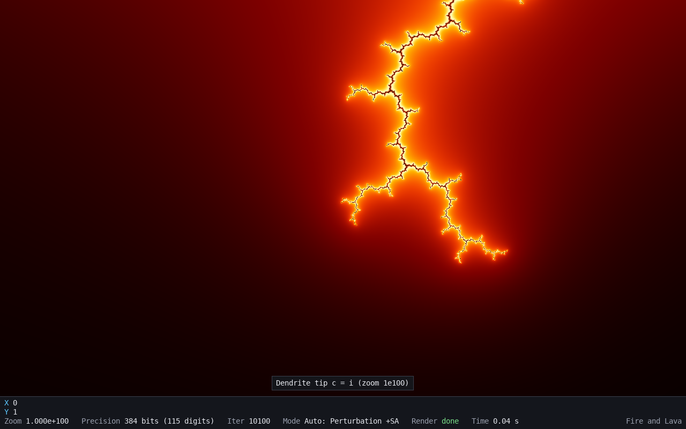
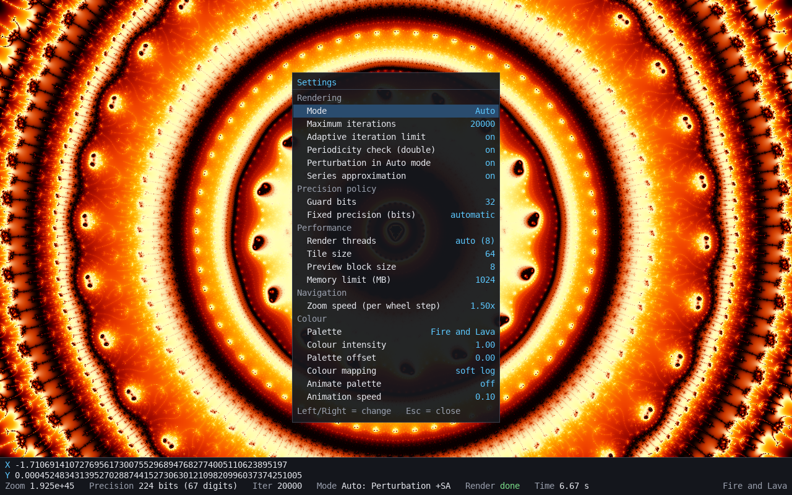

# Mandelbrot Infinity — Deep Zoom Explorer

A native Linux Mandelbrot explorer written in FreeBASIC. It combines a fast
double-precision renderer with an arbitrary-precision (MPFR) reference
renderer and a perturbation renderer, so you can zoom from the full set to
magnifications of 10^100, 10^1000 and beyond while the picture stays
mathematically correct.

Developer: **retro778** · Licence: MIT · Version 1.0.0



*Rings around a mini-Mandelbrot at zoom 1.9 × 10^45, rendered by the perturbation renderer at 224 bits.*

## Screenshots

| | |
|---|---|
|  Home view |  Seahorse double spiral, zoom 6 × 10^8 |
|  Mini-Mandelbrot of period 19 |  Dendrite tip at zoom 10^100 |
|  Settings panel | |

## Features

- Interactive SDL2 window: resizable (minimum 800×600), fullscreen,
  high-DPI aware, dark UI with status bar, help overlay, context menu,
  settings, bookmark and export panels.
- Three renderers, selected automatically or by hand:
  - **Double** — native 64-bit floating point, cardioid/bulb tests,
    optional periodicity check.
  - **MPFR** — every pixel iterated in arbitrary precision. Slow, simple,
    and the reference everything else is tested against.
  - **Perturbation** — one MPFR reference orbit plus hardware-float
    deltas, with rebasing (no glitches), an extended-exponent path for
    zooms beyond 10^300, and optional series approximation.
- The view (centre and scale) is always stored in MPFR; coordinates never
  pass through a `DOUBLE`. Precision grows automatically with zoom depth.
- Progressive, tiled, multi-threaded rendering that never blocks the UI;
  pan and zoom show an instant preview from the previous frame.
- Smooth (band-free) colouring, eight built-in palettes, custom palette
  files, palette offset, intensity and animation.
- Bookmarks and location presets in readable text files with exact decimal
  coordinates.
- PNG export at any resolution with supersampling and a metadata file;
  headless rendering from the command line.
- Finder for mini-Mandelbrots (period detection + Newton's method).
- One-key verification of the current frame against the MPFR reference.

## System requirements

- 64-bit Linux (developed and tested on MX Linux, x86_64).
- FreeBASIC 64-bit compiler `fbc` with the GCC back end (developed with
  version 1.20.0).
- SDL2, SDL2_ttf, MPFR, GMP, libpng, zlib.
- Any multi-core CPU; rendering uses all cores by default.

## Installation on MX Linux / Debian

Runtime and development packages:

```sh
sudo apt install libsdl2-dev libsdl2-ttf-dev libmpfr-dev libgmp-dev libpng-dev zlib1g-dev
```

To only *run* a pre-built binary, the runtime packages are enough:

```sh
sudo apt install libsdl2-2.0-0 libsdl2-ttf-2.0-0 libmpfr6 libgmp10 libpng16-16
```

FreeBASIC itself comes from <https://www.freebasic.net> if your
distribution does not package it. If `fbc` is not on your
`PATH`, pass it to the scripts: `FBC=/path/to/fbc ./scripts/build.sh`.

## Building

```sh
./scripts/build.sh        # produces ./mandelbrot-infinity
./scripts/test.sh         # builds and runs the automated tests (about 80 s)
```

The build is a single `fbc` invocation
(`fbc -gen gcc -O 3 -mt -i include -i src src/main.bas`); the script first
checks that the compiler and all libraries are present and prints the `apt`
command if something is missing.

## Running

```sh
./scripts/run.sh                      # build if needed, check libraries, start
./mandelbrot-infinity --help
./mandelbrot-infinity --location "Seahorse Valley"
./mandelbrot-infinity --x 0 --y 1 --zoom 1e100
```

Headless rendering (no window):

```sh
./mandelbrot-infinity --render out.png --size 3840x2160 --ss 2 \
    --x -0.743643887037158704752191506114774 \
    --y  0.131825904205311970493132056385139 --zoom 6e8 --iter 6000
```

`out.png.txt` is written next to the image with the exact parameters.

User files live in `~/.config/mandelbrot-infinity/` (`settings.ini`,
`bookmarks.ini`, `palettes/*.pal`); exported images go to
`~/Pictures/mandelbrot-infinity/` unless `export_dir` in `settings.ini`
says otherwise.

## Controls

### Mouse

| Action | Effect |
|---|---|
| Wheel up / down | Zoom in / out, centred on the cursor |
| Left drag | Pan |
| Double click | Zoom towards the cursor |
| Right click | Navigation menu (zoom here, centre here, locations, ...) |
| Middle click | Centre on the cursor |

### Keyboard

| Key | Effect |
|---|---|
| Arrow keys | Pan (hold Shift for fine steps) |
| `+` / `-` (also PgUp / PgDn) | Zoom in / out |
| `R` or Home | Reset to the full Mandelbrot set |
| `F` or F11 | Toggle fullscreen |
| `C` / Shift+`C` | Next / previous palette (`1`–`9` select directly) |
| `[` `]` | Palette offset |
| `,` `.` | Colour intensity |
| `A` | Animated palette rotation on / off |
| `I` / `K` | Double / halve the maximum iterations |
| `T` | Type an iteration count |
| `M` | Rendering mode: Auto → Double → MPFR → Perturbation |
| `B` | Add a bookmark |
| `O` | Bookmark list (Enter = go, F2 = rename, Del = delete, E = export, I = import) |
| `L` | Interesting locations |
| `G` | Go to coordinates (paste with Ctrl+V) |
| `N` | Find a mini-Mandelbrot inside the current view and frame it |
| `S` | Save PNG (resolution presets, custom size, supersampling, transparency) |
| `V` | Verify 64 random pixels of the frame against the MPFR reference |
| Tab | Settings |
| `H` or F1 | Help |
| Esc | Close panel → cancel export / search / render → quit |

Zoom speed, thread count, tile size, preview block size, guard bits, fixed
precision, memory limit and the colour options are all in the settings
panel (Tab) and are saved to `settings.ini`.

## The mathematics

A complex number *c* belongs to the Mandelbrot set when the orbit

    z(0) = 0,   z(n+1) = z(n)^2 + c

stays bounded. An orbit that ever leaves the disc |z| ≤ 2 escapes to
infinity, so "|z|² > 4" decides membership. The program keeps iterating to
radius 256: an orbit that passed 2 always reaches 256 a few steps later, so
the classification is identical, but the *smooth iteration value*

    nu = n + 1 − log2( ln|z(n)| / ln 256 )

is far more accurate at the larger radius. `nu` varies continuously across
the plane, which removes the colour bands of plain escape counts.

Points that never escape within the iteration limit are drawn black. Two
shortcuts avoid wasted work: closed-form tests for the main cardioid and the
period-2 disc, and (in double mode) a periodicity check that stops as soon
as the orbit repeats exactly.

Colours are taken from `log(1 + (nu − nu_min) / 24)` by default, where
`nu_min` is the lowest value in the frame. Deep views, where every pixel
needs tens of thousands of iterations, therefore get the same contrast as
shallow ones. Linear and square-root mappings are available in the settings.

The pixel grid is square: the view is defined by its centre and its half
height, and one pixel is `2 · half_height / image_height` wide in both
directions. "Zoom" on screen is magnification relative to the home view
(half height 1.25).

## Arbitrary-precision rendering

At magnification *M* neighbouring pixels differ around the
log2(*M*)-th binary digit. A `DOUBLE` has 53 bits, so somewhere past 10^13
adjacent pixels become indistinguishable and the picture dissolves into
blocks. The program handles this as follows.

**Coordinates.** Centre and scale are MPFR numbers. Every navigation step
(zoom at cursor, pan, go to) is computed in MPFR, and the precision of the
centre grows with the zoom. Bookmarks and metadata store decimal strings
with all digits, plus the binary precision, so a reloaded view is
bit-identical.

**Precision policy.** Working precision = 2 + bits needed to resolve a pixel
+ guard bits (default 32), rounded up to a multiple of 32, minimum 64. A
fixed precision can be forced in the settings; if it (or manual Double mode)
cannot separate neighbouring pixels, the status bar says so in red rather
than showing a wrong picture without comment.

**MPFR mode** iterates every pixel at that precision. It is the reference
implementation.

**Perturbation mode** computes only the orbit of the centre point *C* in
MPFR and stores it as doubles (*Z(n)*). Each pixel *c = C + δc* then
iterates its *difference* from that orbit,

    δ(n+1) = 2·Z(n)·δ(n) + δ(n)² + δc

which needs no more than hardware precision because δ is tiny. The classic
failure of this method ("glitches") happens when the pixel's orbit comes
closer to zero than to the reference. The program uses *rebasing*: whenever
|Z + δ| < |δ|, or the reference orbit ends, δ is replaced by the full value
*z* and the reference index restarts at 0. This is exact, so no second
reference orbit is needed.

Beyond about 10^300 a delta no longer fits a double's exponent. The
renderer then carries δ as *w · 2^E* with *w* near 1 and re-normalises
occasionally; the rare reference values below 10^-60 are stored with their
own exponent and take a slower, fully general step.

**Series approximation** (optional, on by default): δ(n) is a polynomial in
δc. The first three coefficients are iterated along the reference orbit and
used to skip the first iterations of every pixel. The skip length is limited
by comparing the series with 16 directly iterated probe orbits on the circle
enclosing the image (tolerance 10^-12) — the truncation error is analytic in
δc, so its maximum over the image lies on that circle.

**Automatic mode** uses Double while a pixel is at least 2^-32 wide, then
Perturbation (or MPFR when perturbation is switched off).

**Adaptive iterations.** When a frame finishes and more than 0.1 % of its
pixels escaped only in the upper half of the iteration budget, the limit is
doubled and only the pixels that hit the old limit are recomputed.

### Why not "infinite" zoom?

Each further factor of 10 needs about 3.32 more bits in every coordinate
and, for most locations, more iterations. Memory and time per frame
therefore grow without bound as you zoom, while a computer has a fixed
amount of both. What is possible is zoom limited only by your patience: the
program has a sanity cap of 3,000,000 bits (about 10^900000), and practical
limits arrive much earlier (see below).

## Verification

`./scripts/test.sh` runs 212 checks without opening a window:

- escape counts for known points; interior/exterior classification in all
  renderers;
- coordinate mapping, square pixels, zoom-at-cursor invariance (the point
  under the cursor moves less than 10^-9 pixel, tested down to a half height
  of 10^-1000);
- MPFR arithmetic against known values (√2 to 60 digits; the period-3
  nucleus as a root of c³ + 2c² + c + 1; c = −2 − 10^-300 escapes);
- precision selection and the "insufficient precision" flag;
- bookmark and settings round trips, 5000-bit coordinates, corrupt files;
- palette tables (step ≤ 2 levels, cyclic), custom palette parsing;
- identical output for 1 thread / 1 pass and 8 threads / 5 passes / small
  tiles; refinement passes; cancellation; generation ids; memory limit;
- PNG export (signature, size, metadata, transparency, failure, cancel);
- **deep-zoom regression**: the perturbation renderer, with and without
  series approximation, is compared pixel by pixel with the MPFR reference
  at 10^0, 10^3, 10^6, 10^12, 10^30, 10^100, 10^320 and 10^1000, and at
  three Newton-verified mini-Mandelbrots (10^25, 10^46, 10^92).

Results of that last group on the development machine: at the dendrite tip
*c = i* the two renderers agree to better than 10^-8 in `nu` at every depth;
at the mini-Mandelbrots there are zero misclassified and zero deviating
pixels. In chaotic regions near the set boundary a handful of pixels per
thousand differ between *any* two computations (including MPFR at two
different precisions) because their value changes over distances far below
a pixel; the tests allow 1 % of pixels to differ by more than a 1/50-pixel
shift and the measured figures are 0–0.7 %.

Both optimisations (perturbation and series approximation) are enabled by
default because they pass these tests. Inside the program, `V` repeats the
comparison for 64 random pixels of whatever is on screen.

## Performance

Measured with `tests/bench` on an Intel Core i7-1165G7 (4 cores, 8
threads), FreeBASIC 1.20 with `-gen gcc -O 3`, full frame of 1280×740
unless noted:

| View | Zoom | Max iter | Renderer | Bits | Size | Seconds |
|---|---|---|---|---|---|---|
| Home | 1 | 500 | Double | 53 | 1280x740 | 0.02 |
| Home | 1 | 500 | Perturbation + series | 64 | 1280x740 | 0.03 |
| Home | 1 | 500 | MPFR | 64 | 1280x740 | 0.43 |
| Seahorse Valley | 35.7 | 1500 | Double | 53 | 1280x740 | 0.04 |
| Seahorse spiral | 6.25e+8 | 6000 | Perturbation + series | 96 | 1280x740 | 1.17 |
| Seahorse spiral | 6.25e+8 | 6000 | Perturbation | 96 | 1280x740 | 1.17 |
| Seahorse spiral | 6.25e+8 | 6000 | MPFR | 96 | 320x185 | 2.75 |
| Mini, period 64 | 1.03e+13 | 8000 | Perturbation + series | 96 | 1280x740 | 0.54 |
| Embedded Julia rings | 4.22e+23 | 3000 | Perturbation + series | 128 | 1280x740 | 0.89 |
| Embedded Julia rings | 4.22e+23 | 3000 | MPFR | 128 | 320x185 | 3.58 |
| Rings around a mini | 1.93e+45 | 20000 | Perturbation + series | 224 | 1280x740 | 6.15 |
| Mini, period 1339 | 2.57e+46 | 40000 | Perturbation + series | 224 | 1280x740 | 10.81 |
| Dendrite tip | 1.00e+100 | 2000 | Perturbation + series | 384 | 1280x740 | 0.05 |
| Dendrite tip | 1.00e+100 | 2000 | Perturbation | 384 | 1280x740 | 0.38 |
| Dendrite tip | 1.00e+100 | 2000 | MPFR | 384 | 320x185 | 1.71 |
| Dendrite tip | 1.00e+1000 | 8000 | Perturbation + series | 3392 | 1280x740 | 2.90 |
| Dendrite tip | 1.00e+1000 | 8000 | Perturbation | 3392 | 1280x740 | 4.64 |
| Dendrite tip | 1.00e+10000 | 60000 | Perturbation + series | 33280 | 1280x740 | 34.21 |

The MPFR rows use a sixteen times smaller image; scaled to the full frame
the perturbation renderer is roughly 40× (spiral) to 500× (10^100) faster.
These are measurements on one machine, not guarantees.

Things that matter for speed:

- Time per frame is governed by iterations per pixel, not by zoom depth
  as such. The dendrite needs about 2.7 iterations per decimal digit of
  zoom; a deep mini-Mandelbrot needs tens of thousands.
- Interior pixels cost the full iteration limit in the MPFR and
  perturbation renderers, so views filled by a mini-set are the slowest.
- The reference orbit costs 16 bytes per iteration; the iteration limit is
  capped so that it fits a quarter of the memory limit (default 1024 MB).
- Image buffers take 12 bytes per pixel on screen and 4 bytes per rendered
  pixel during export; an export that would exceed the memory limit is
  refused with a message.

## Known limitations

- Series approximation uses three terms and stops at the first near-zero
  point of the reference orbit, which for a view centred on a
  mini-Mandelbrot is one period. Such views are correct but slow: the
  period-8072 mini at 10^92 takes about 20 s at 640×400, the period-56568
  one at 10^175 about 3 minutes. Bilinear approximation (BLA), which
  modern deep zoomers use here, is not implemented.
- No interior detection beyond the cardioid and period-2 disc (and the
  periodicity check in Double mode).
- Glitch avoidance relies on rebasing; there is no separate automatic
  glitch detector. The `V` check samples 64 pixels, it does not prove the
  whole frame.
- The comparison against MPFR stops at 10^1000 because the reference
  becomes too slow. 10^10000 runs through the same code path and renders
  the expected self-similar dendrite, but is not checked against MPFR.
- Colours are relative to each frame's lowest iteration value, so hues can
  shift slightly from one frame to the next while navigating.
- Supersampling is a plain box filter in sRGB space.
- Interactive behaviour was exercised with scripted mouse and keyboard
  input on a virtual X display (software rendering). High-DPI scaling and
  desktop-compositor fullscreen are implemented but were not tried on a
  physical HiDPI screen.
- Linux only, by design.

## Files

```
src/main.bas            entry point, command line, headless rendering
src/app.bas             window, input, main loop, panels
src/ui.bas              text, menus, prompts
src/engine.bas          includes everything below (no SDL needed)
src/settings.bas        paths, INI files, settings
src/navigation.bas      MPFR numbers <-> text, view, zoom/pan
src/palette.bas         palettes and colouring
src/renderer_double.bas Mode A
src/renderer_mpfr.bas   Mode B (reference)
src/perturbation.bas    reference orbit, rebasing, series approximation
src/renderer.bas        jobs, threads, tiles, progressive passes
src/nucleus.bas         mini-Mandelbrot finder
src/bookmarks.bas       bookmarks and location presets
src/export_png.bas      PNG export and metadata
include/common.bi       shared types and constants
include/mpfr_bindings.bi  MPFR declarations (FreeBASIC ships none)
data/locations/locations.ini   presets (editable)
assets/palettes/*.pal   example custom palettes (format in README.txt there)
assets/fonts/           DejaVu Sans Mono and its licence
tests/test_main.bas     automated tests      tests/bench.bas   benchmark
tools/deepfind.bas      developer tool that produced the deep presets
```

## Licence

The original code, scripts, palettes and data of this project are released
under the MIT License (see `LICENSE`), copyright 2026 retro778.

That licence does not extend to the libraries the program links against
(SDL2, SDL2_ttf, MPFR, GMP, libpng, zlib, the FreeBASIC runtime) or to the
bundled DejaVu font; their licences are listed in `THIRD-PARTY.md`.
